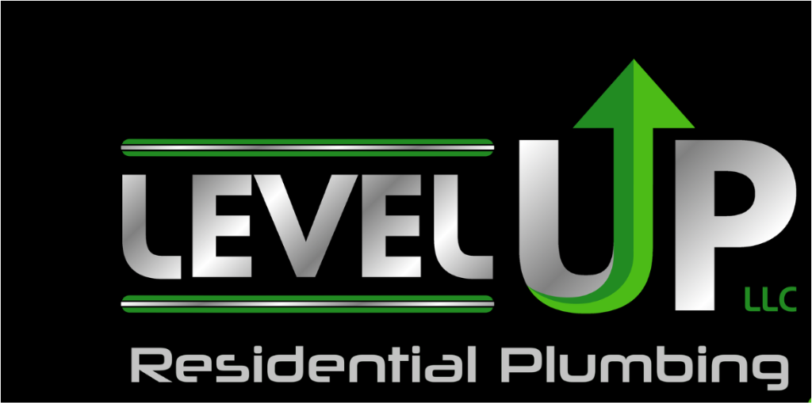

# Level Up Residential Plumbing LLC — Website

Official, modern, conversion-focused residential plumbing website for **Level Up Residential Plumbing LLC**, located in Dallas, Oregon (97338).



## Business Information
- **Business Name**: Level Up Residential Plumbing LLC
- **Industry**: Residential Plumbing
- **Address**: 206 NW Denton Ave, Dallas, OR 97338, United States
- **Direct Phone**: [+1 (971) 312-7910](tel:+19713127910)
- **Licensing**: Oregon CCB #249033 (Licensed, Bonded & Insured)
- **Customer Rating**: 5.0 Stars (146 Verified Reviews)
- **Official Website**: [https://lvlupplumbing.com/](https://lvlupplumbing.com/)

---

## Website Features & Architecture
- **Conversion-Driven Homepage (`index.html`)**: Clear value propositions, trust strip, 3-step process, interactive tools, and direct call actions.
- **Interactive Residential Plumbing Estimator**: Instant project pricing guidance for homeowners.
- **Dallas, OR ZIP Code Coverage Checker**: Real-time service area validator for 97338 and Polk County.
- **Dedicated Service Pages**:
  - `services/faucet-sink-installation.html`
  - `services/water-heater-services.html`
  - `services/water-pressure-prv.html`
  - `services/drain-overflow-replacement.html`
  - `services/pipe-repair-inspection.html`
- **Customer Reviews Hub (`reviews.html`)**: Scorecard, theme tags, and direct Google review links.
- **Service Areas (`service-areas.html`)**: Dallas, OR, Monmouth, Independence, West Salem, and Polk County.
- **Contact & Appointment Form (`contact.html`)**: Interactive validation and reference number generation.
- **Compliance & Legal**: `privacy-policy.html` and `terms-of-use.html`.
- **SEO Ready**: Semantic HTML5, Schema.org `Plumber` / `LocalBusiness` JSON-LD, `sitemap.xml`, and `robots.txt`.

---

## How to Run Locally

You can run the built-in zero-dependency server:

```bash
node server.js
```

Then visit:
```
http://localhost:3000
```
